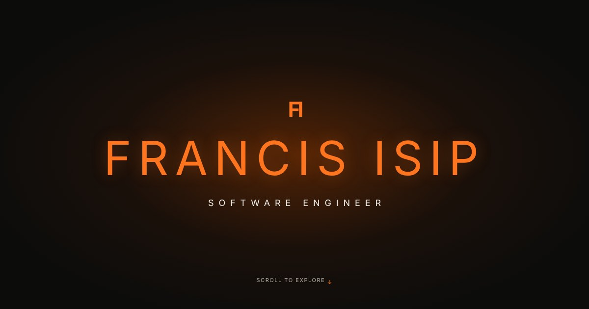

# Francis "Butch" Isip, Software Engineer

My personal portfolio site: **[650buxks.github.io/MyCV](https://650buxks.github.io/MyCV/)**



I'm a Bay Area software engineer moving from four years of diagnosing complex physical systems in my family's plumbing business into building full-stack applications with Python and Django.

## Featured project

**[Clique](https://github.com/650buxks/Inner-Circle)** ([live demo](https://clique-qe18.onrender.com/)) is a real-time messaging app for small friend groups, with direct and group chats, media sharing and polls. It uses Claude to summarize missed messages, draft replies and suggest polls, which users review before posting.

Built with Python, Django Channels, WebSockets, Redis and PostgreSQL.

### Other projects

- [News Application](https://github.com/650buxks/Django-News-app): Django app with reader, journalist and editor roles, article approval workflows, newsletters and subscriptions.
- [Shelf Tracker](https://github.com/650buxks/shelf-tracker): command-line book inventory backed by SQLite.
- [Task Manager](https://github.com/650buxks/task-manager): command-line app for users, tasks and completion reports.

## About this site

A single static page with no framework or build step, hosted on GitHub Pages.

- **HTML and CSS** for layout, with a dark theme and responsive breakpoints for phones.
- **Vanilla JavaScript** for scroll effects:
  - an animated intro on the opening screen
  - section reveals using `IntersectionObserver`
  - a pinned quote whose words light up as you scroll
  - a scroll progress bar
- **Reduced motion support.** Every animation is skipped for visitors who turn on reduced motion in their device settings.
- **Optimized images** stored as WebP files in `images/`, with link-preview tags so shared links show a title, description and image.

### Run it locally

Clone the repo and open `index.html` in a browser, or serve the folder:

```bash
python3 -m http.server 8000
```

Then visit http://localhost:8000.

## Contact

- Email: isipf908@gmail.com
- LinkedIn: [francis-isip-07b029240](https://linkedin.com/in/francis-isip-07b029240)
